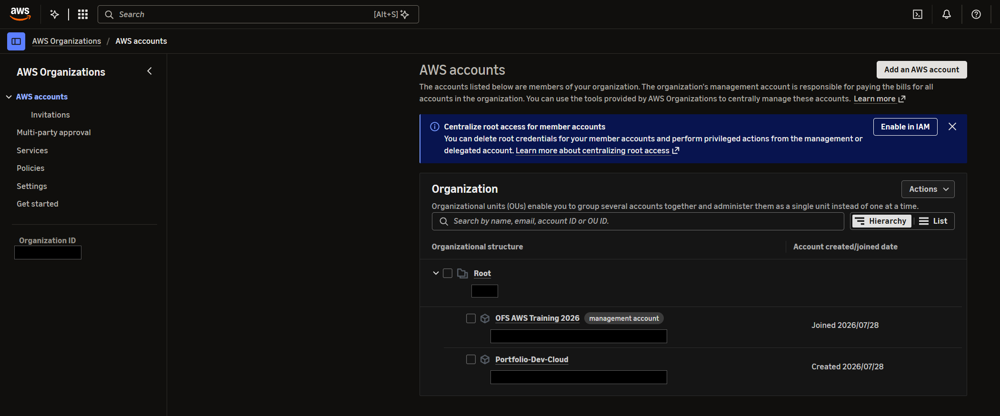
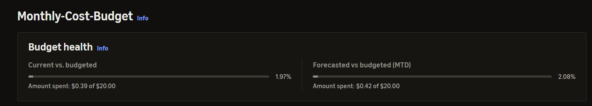
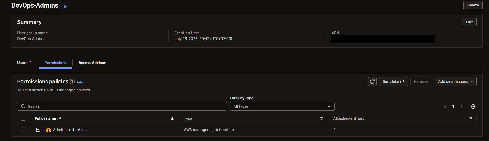

# Proyecto 01: Base de seguridad y control de costes en AWS

## 📝 Visión general

Configuración inicial de mi entorno de AWS, hecha **antes de desplegar ningún recurso**. Sigue los pilares de **Seguridad** y **Optimización de costes** del AWS Well-Architected Framework.

El objetivo es reducir el "radio de impacto" de cualquier error separando los entornos de trabajo, aplicar buenas prácticas de gestión de identidades (MFA, grupos de IAM y no usar el usuario root) y poner controles básicos de costes (FinOps) desde el primer día.

## 🏗️ Arquitectura y servicios utilizados

* **AWS Organizations:** gestión multicuenta y aislamiento estructural.
* **AWS IAM (Identity and Access Management):** control de acceso, políticas por grupo y alias de inicio de sesión.
* **AWS Budgets:** control proactivo del gasto y alertas ante costes inesperados.
* **AWS Billing and Cost Management:** facturación consolidada y acceso de IAM a la información de costes.

## 🚀 Qué se implementó

### 1. Estrategia multicuenta y aislamiento del radio de impacto
* Usé **AWS Organizations** para pasar de una cuenta única a una jerarquía con una cuenta de administración y una cuenta miembro.
* Creé una cuenta miembro dedicada (`Portfolio-Dev-Cloud`) para separar los proyectos del portfolio de la cuenta de administración, y mantener cada entorno limpio y aislado.
* Activé la **facturación consolidada** para centralizar el seguimiento de costes a nivel de la organización.

### 2. Control de costes (FinOps)
* Di acceso a la información de facturación a las identidades de IAM, para que los administradores operativos vean los costes de los recursos.
* Configuré un **presupuesto mensual de 20 USD** (`Monthly-Cost-Budget`) en la cuenta de administración con AWS Budgets, para vigilar el coste conjunto de toda la organización.
* Configuré dos alertas por email: una cuando el **coste real supera 2 USD** y otra cuando la **previsión de gasto supera el 100 %** del presupuesto.

### 3. Identidad y acceso (IAM)
* **Protección del usuario root:** activé la autenticación multifactor (MFA) en el usuario root de la cuenta de administración y de la cuenta miembro, y dejé de usarlos para el trabajo diario.
* **Acceso por grupos:** creé un grupo de IAM `DevOps-Admins` con la política gestionada `AdministratorAccess`, siguiendo la buena práctica de no asignar políticas directamente a usuarios individuales.
* **Identidad para el día a día:** creé un usuario de IAM dedicado a las tareas diarias, protegido con su propio MFA.
* **URL de acceso personalizada:** configuré un alias de cuenta (`portfolio-dev-cloud`) para tener un enlace de inicio de sesión legible para los usuarios de IAM.

## 📸 Evidencias

*(Los identificadores de cuenta y los emails se han tapado en las capturas.)*

### 1. Organización con la cuenta de administración y la cuenta miembro

### 2. Presupuesto mensual con alertas

### 3. Grupo de IAM con su política

## 🧠 Lecciones aprendidas y buenas prácticas
* **No usar nunca el usuario root** para las tareas diarias: se trabaja siempre con identidades de IAM.
* Los presupuestos de AWS Organizations no se muestran en las cuentas miembro, pero un presupuesto global en la cuenta de administración sí controla el gasto agregado.
* Poner límites de coste *antes* de desplegar infraestructura es clave para evitar cargos inesperados, sobre todo al trabajar con entornos propios.
* Los umbrales de las alertas hay que dimensionarlos: uno alto tarda días en avisar de un recurso que se queda encendido y cobra por horas. Por eso añadí una alerta temprana de coste real y otra sobre la previsión.

## ⚖️ Limitaciones conocidas

| Tema | Estado actual | Qué haría en un entorno de empresa |
| :--- | :--- | :--- |
| Permisos del usuario diario | El grupo `DevOps-Admins` tiene `AdministratorAccess`. Es cómodo para una cuenta personal, pero concede más permisos de los necesarios. | Políticas ajustadas a cada rol y mínimo privilegio. |
| Usuarios de IAM con credenciales permanentes | El acceso diario usa un usuario de IAM con MFA. | **IAM Identity Center**, con credenciales temporales y acceso centralizado. |
| Controles a nivel de organización | Fuera del alcance de este proyecto. | Políticas de control de servicios (SCP) y registro de auditoría con CloudTrail para toda la organización. |
