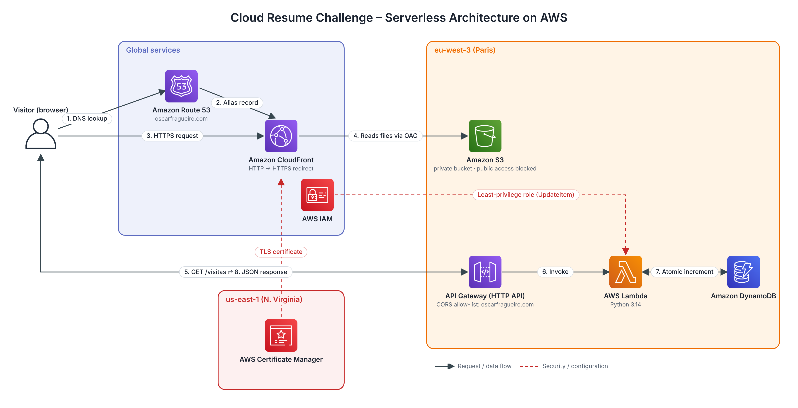
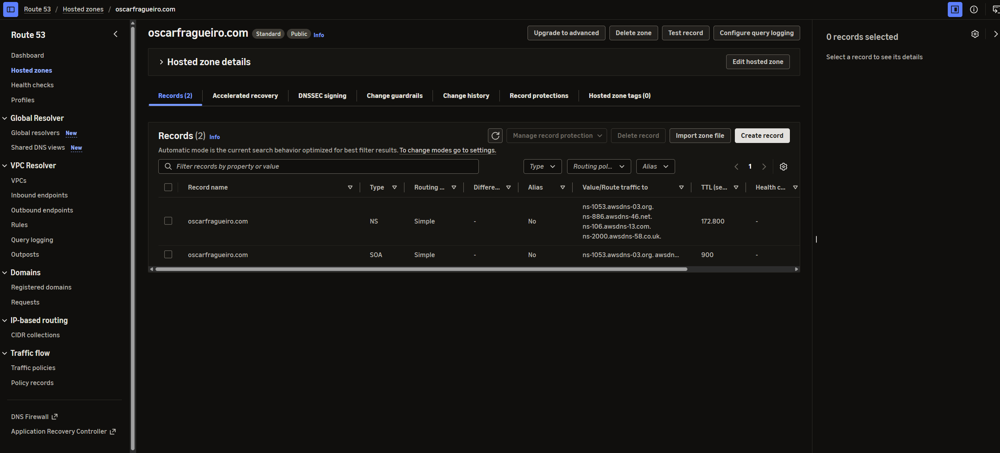
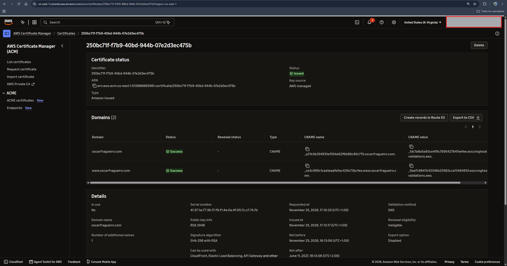
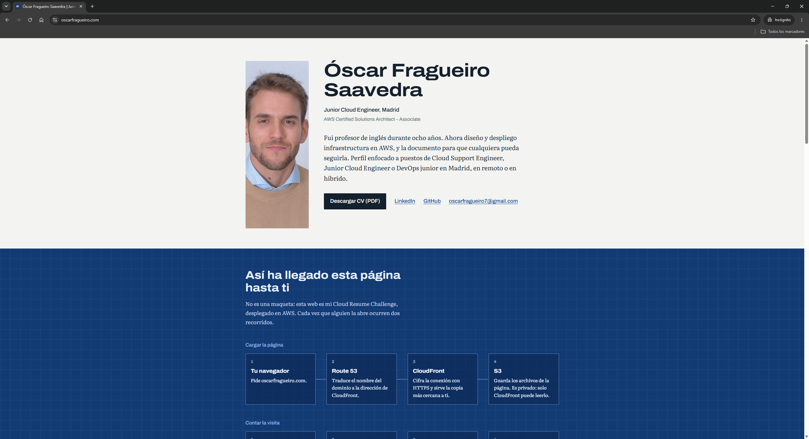
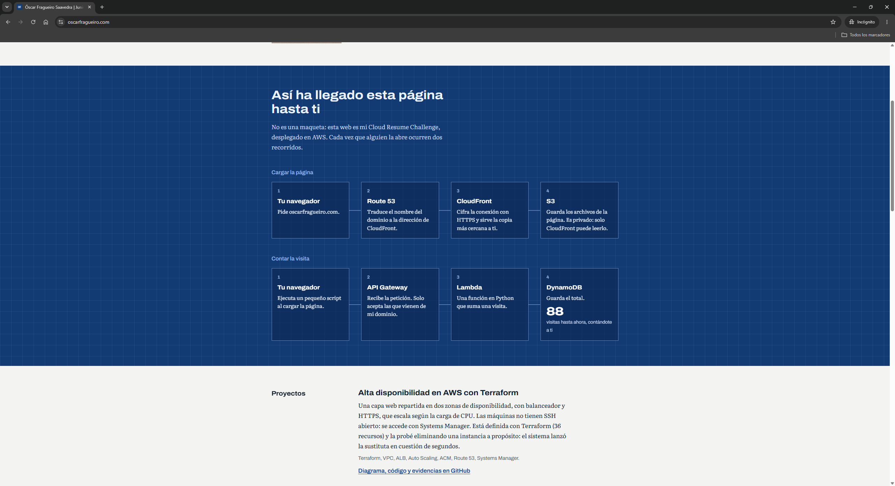

# ☁️ Cloud Resume Challenge: currículum serverless en AWS

[](#)
[](#)
[](#)

🔗 **Web en vivo:** [oscarfragueiro.com](https://oscarfragueiro.com)

## 📌 Visión general

Mi implementación del [Cloud Resume Challenge](https://cloudresumechallenge.dev/): un currículum web con un contador de visitas, construido con una **arquitectura 100 % serverless** en AWS y publicado en un **dominio propio con HTTPS**.

Todos los componentes son servicios gestionados y de pago por uso, así que el coste de una web con poco tráfico es mínimo. La infraestructura se desplegó a mano desde la consola de AWS (ClickOps) a propósito, para entender cómo se comporta cada servicio antes de automatizarlo. La infraestructura como código y el CI/CD son las siguientes iteraciones (ver el [roadmap](#-roadmap)).

## ✅ Progreso del reto

| Paso | Estado |
| :--- | :---: |
| Web estática (HTML/CSS/JS) alojada en S3 | ✅ |
| HTTPS mediante CloudFront | ✅ |
| Dominio propio (Route 53) y certificado (ACM) | ✅ |
| Contador de visitas en JavaScript que llama a una API | ✅ |
| Base de datos (DynamoDB) | ✅ |
| API (API Gateway) + Lambda (Python) | ✅ |
| Tests automáticos de la Lambda | ⬜ Pendiente |
| Infraestructura como código | ⬜ Pendiente |
| Pipeline de CI/CD (GitHub Actions) | ⬜ Pendiente |

## 🏗️ Arquitectura



**Flujo de una petición**

1. El visitante entra en `oscarfragueiro.com`. **Route 53** resuelve el dominio hacia **CloudFront** (registro Alias).
2. CloudFront presenta el certificado de **ACM** (HTTPS) y sirve el contenido desde un bucket **S3** privado, al que accede mediante **OAC**.
3. El JavaScript de la página llama a `GET /visitas` en **API Gateway**.
4. API Gateway invoca la función **Lambda**.
5. Lambda incrementa el contador de forma atómica en **DynamoDB**.
6. DynamoDB devuelve el valor actualizado y la Lambda lo devuelve en JSON.
7. El navegador muestra el contador en la página.

## 🛠️ Servicios utilizados

| Capa | Servicio | Función |
| :--- | :--- | :--- |
| DNS | **Amazon Route 53** | Registro del dominio y zona alojada; registros Alias (`A`) hacia CloudFront para el dominio raíz y `www`. |
| Certificado | **AWS Certificate Manager** | Certificado público gratuito para `oscarfragueiro.com` y `www`, validado por DNS. Debe estar en `us-east-1` para poder usarse con CloudFront. |
| Frontend | **Amazon S3** | Alojamiento estático. Acceso público bloqueado; el bucket no es legible públicamente. |
| Frontend | **Amazon CloudFront** | CDN global con HTTPS; redirige automáticamente HTTP a HTTPS. Lee de S3 mediante **OAC** (Origin Access Control). |
| Backend | **Amazon API Gateway (HTTP API)** | Punto de entrada público; enruta `GET /visitas` hacia Lambda y gestiona CORS. |
| Backend | **AWS Lambda (Python 3.14)** | Lógica del contador: actualiza el valor y devuelve JSON. |
| Backend | **Amazon DynamoDB** | Tabla NoSQL que guarda el contador de forma persistente. |
| Seguridad | **AWS IAM** | Rol de ejecución de la Lambda con política de mínimo privilegio. |

## 🛡️ Seguridad

- **S3 privado.** Solo CloudFront puede leer el bucket, a través de OAC.
- **HTTPS** con certificado de ACM en el dominio propio, y redirección automática de HTTP a HTTPS en CloudFront.
- **Mínimo privilegio en IAM.** El rol de la Lambda solo permite lo que la función hace de verdad: actualizar un elemento de una tabla concreta y escribir logs.

```json
{
  "Version": "2012-10-17",
  "Statement": [
    {
      "Effect": "Allow",
      "Action": "dynamodb:UpdateItem",
      "Resource": "arn:aws:dynamodb:eu-west-3:<ACCOUNT_ID>:table/visitas-portfolio"
    }
  ]
}
```

A este rol se añade la política gestionada `AWSLambdaBasicExecutionRole`, que permite escribir logs en CloudWatch.

- **CORS restringido en API Gateway.** Solo los orígenes de mi web (`https://oscarfragueiro.com`, `https://www.oscarfragueiro.com` y el dominio `cloudfront.net` de la distribución) pueden consumir la API desde un navegador. Cuando CORS está configurado en API Gateway, este ignora las cabeceras CORS que devuelva la Lambda, por lo que la función no las incluye.

Para comprobarlo, se hace una petición con `curl` simulando distintos orígenes:

```bash
# Origen permitido: la respuesta incluye access-control-allow-origin
curl -i -H "Origin: https://oscarfragueiro.com" https://<API_ID>.execute-api.eu-west-3.amazonaws.com/visitas

# Origen ajeno: la respuesta no incluye ninguna cabecera CORS
curl -i -H "Origin: https://example.com" https://<API_ID>.execute-api.eu-west-3.amazonaws.com/visitas
```

## 📸 Evidencias

### 1. Dominio registrado en Route 53


### 2. Certificado de ACM emitido
Certificado válido para el dominio raíz y para `www`, validado por DNS.



### 3. La web servida por HTTPS en el dominio propio


### 4. Contador de visitas funcionando
La web en `oscarfragueiro.com` consume la API con el CORS restringido a mis dominios.



## 🧠 Retos técnicos y lecciones aprendidas

**1. Caché de CloudFront y contenido obsoleto**
- *Problema:* las actualizaciones del frontend no aparecían en producción porque CloudFront seguía sirviendo objetos cacheados desde sus ubicaciones de borde.
- *Solución:* crear una invalidación de caché (`/*`) después de cada subida a S3.
- *Siguiente paso:* automatizarlo en el pipeline de CI/CD.

**2. Condiciones de carrera en el contador**
- *Problema:* si dos visitantes llegan a la vez, un ciclo leer → sumar → escribir en la aplicación puede perder incrementos.
- *Solución:* delegar la suma en DynamoDB con `UpdateExpression='ADD cantidad :inc'` desde `boto3`, que es una operación atómica y no necesita bloqueos en la aplicación.

**3. CORS: de `*` a orígenes explícitos**
- *Problema:* el navegador bloqueaba las llamadas del frontend a la API por ser orígenes distintos. La primera solución fue que la Lambda devolviera `Access-Control-Allow-Origin: *`, lo que funcionaba pero permitía que cualquier web usara mi API desde un navegador.
- *Solución:* configurar CORS en API Gateway con la lista exacta de mis dominios y eliminar las cabeceras CORS del código de la Lambda, de modo que haya un único punto de control. Lo verifiqué con `curl` simulando un origen permitido y uno ajeno.
- *Límite:* CORS solo restringe a los navegadores. No impide que alguien llame a la API con `curl` ni con otro programa (ver [limitaciones](#️-limitaciones-conocidas)).

**4. `AccessDenied` y mínimo privilegio en IAM**
- *Problema:* la Lambda fallaba con `AccessDenied` al llamar a DynamoDB.
- *Primera solución:* adjunté `AmazonDynamoDBFullAccess` para desbloquearla. Funcionaba, pero concede muchos más permisos de los necesarios (todas las acciones sobre todas las tablas).
- *Solución final:* reemplazarla por una política propia con solo `dynamodb:UpdateItem` sobre esta tabla, y comprobar después que el contador seguía funcionando.
- *Lección:* una política gestionada amplia sirve para descubrir qué permiso falta, pero nunca debe quedarse como estado final.

**5. Certificado de ACM y la región `us-east-1`**
- *Problema:* al asociar un dominio propio a CloudFront, el certificado no aparecía en el desplegable porque yo trabajaba en la región de París.
- *Solución:* CloudFront solo usa certificados de ACM creados en `us-east-1` (N. Virginia). Pedí el certificado allí, lo validé por DNS creando los registros en Route 53 y lo asocié a la distribución junto con los dominios alternativos.

## ⚖️ Limitaciones conocidas

| Tema | Estado actual | Qué haría en producción |
| :--- | :--- | :--- |
| Semántica del contador | Un `GET` incrementa el contador, así que cada carga de página cuenta (no son visitantes únicos) y un `GET` no es idempotente. | Usar `POST` para la escritura y desduplicar visitantes. |
| Abuso de la API | Cualquiera que conozca el endpoint puede inflar el contador, por ejemplo con `curl`. | Configurar *throttling* en API Gateway y, si hiciera falta, AWS WAF. |
| Despliegue | Subida manual a S3 e invalidación manual. | CI/CD con GitHub Actions. |
| Infraestructura | Creada a mano, no reproducible ni versionada. | Terraform o AWS SAM. |
| Observabilidad | Solo logs de la Lambda en CloudWatch. | Alarmas ante errores de Lambda y respuestas 5xx de la API. |
| Pruebas | Sin tests automáticos. | Tests unitarios con `pytest` y DynamoDB simulado. |

## 💰 Coste

El proyecto se mantiene desplegado de forma permanente. Los costes fijos son el **dominio** (unos 16 USD al año) y la **zona alojada de Route 53** (unos céntimos al mes). Con el tráfico de un portfolio, S3, CloudFront, Lambda, API Gateway y DynamoDB quedan prácticamente en cero, y el certificado de ACM es gratuito.

## 📂 Estructura del repositorio

```text
02-cloud-resume-challenge/
├── frontend/
│   ├── index.html           # Estructura de la página y lógica del cliente (Fetch API)
│   └── assets/              # Recursos estáticos
│       ├── mi-cv.pdf
│       ├── perfil.jpeg
│       └── arquitectura.png
├── backend/
│   └── lambda_function.py   # Actualización atómica del contador en DynamoDB
├── images/                  # Capturas de evidencia para este README
└── README.md
```

## 🚀 Roadmap

- [ ] **Infraestructura como código:** migrar todo el stack a Terraform (o AWS SAM) para despliegues reproducibles y versionados.
- [ ] **Tests:** pruebas unitarias de la Lambda con `pytest` y DynamoDB simulado.
- [ ] **CI/CD:** GitHub Actions para ejecutar los tests, sincronizar con S3 e invalidar CloudFront en cada push, autenticándose en AWS con **OIDC** (sin claves de acceso de larga duración).
- [ ] **Protección de la API:** límites de peticiones (*throttling*) en API Gateway.
- [ ] **Monitorización:** alarmas de CloudWatch ante errores de Lambda y respuestas 5xx de API Gateway.
- [ ] **Artículo:** escribir un post sobre la construcción del proyecto, como sugiere el reto.
