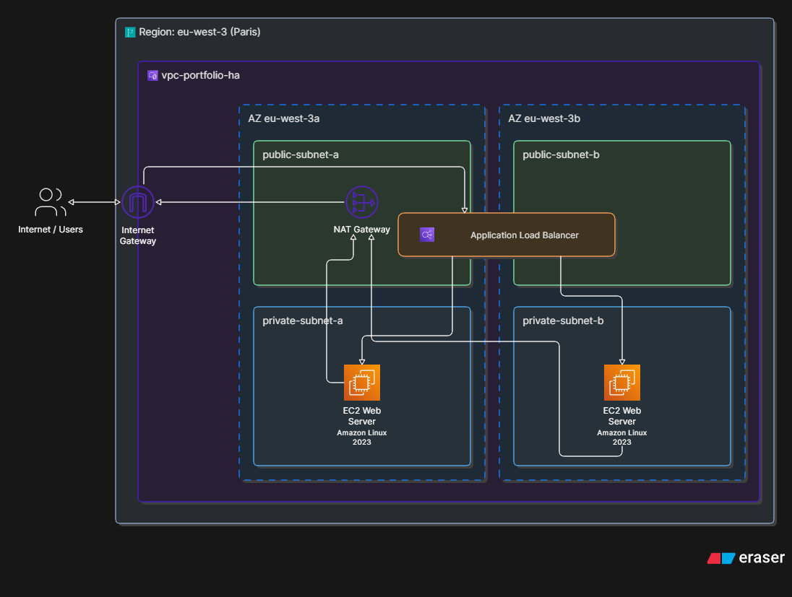
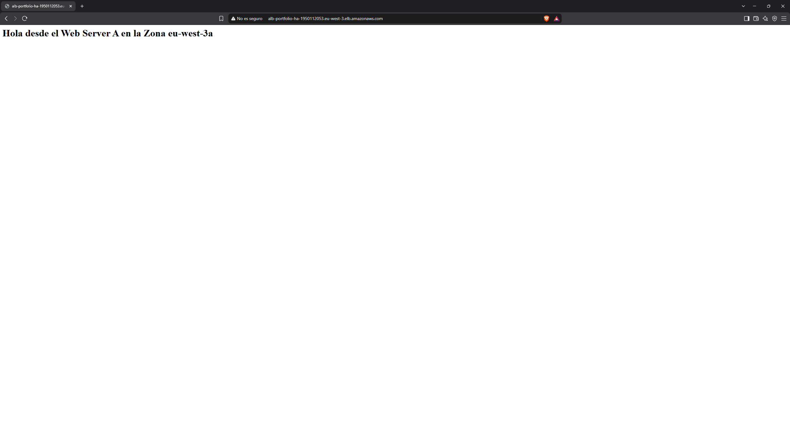
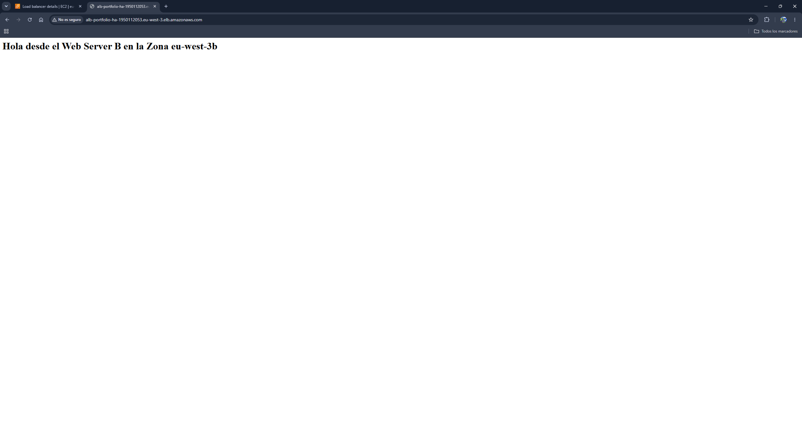
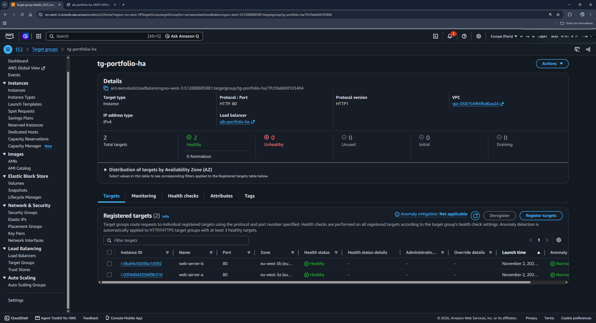
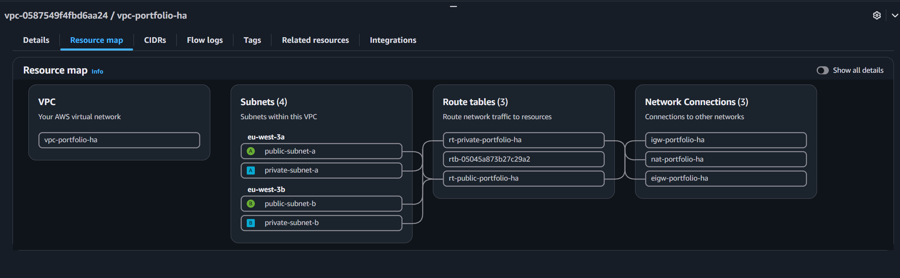

# Arquitectura web de alta disponibilidad en AWS (multi-AZ, subredes privadas)

## 📌 Visión general

Despliegue manual (ClickOps) de una **capa web multi-AZ** en AWS. Dos servidores web funcionan en **subredes privadas**, repartidos en dos zonas de disponibilidad de `eu-west-3` (París). La única entrada desde Internet es un **Application Load Balancer (ALB)** situado en las subredes públicas; los servidores no tienen dirección IP pública. La administración se hace con un **EC2 Instance Connect Endpoint (EICE)** en lugar de un bastión.

El objetivo fue practicar la segmentación de red, el diseño con subredes privadas y el balanceo de carga entre zonas antes de automatizarlo con Infraestructura como Código (ver el [roadmap](#-roadmap)). El entorno se eliminó justo después de documentarlo, para evitar costes.

## 🏗️ Diagrama de arquitectura

## 🛠️ Stack tecnológico y servicios de AWS

- **Red:** Amazon VPC (doble pila IPv4/IPv6), Internet Gateway, NAT Gateway, Egress-Only Internet Gateway, tablas de rutas.
- **Cómputo:** Amazon EC2 (Amazon Linux 2023, `t2.micro`), Target Group.
- **Enrutamiento del tráfico:** Application Load Balancer (expuesto a Internet, doble pila).
- **Seguridad y acceso:** Security Groups, EC2 Instance Connect Endpoint (acceso autenticado con IAM).

## 🔒 Seguridad y decisiones de diseño (el "porqué")

1. **Aislamiento en subredes privadas.** Los servidores web no tienen IP pública, por lo que no se puede llegar a ellos directamente desde Internet (sin SSH expuesto ni superficie de ataque directa).
2. **Un único punto de entrada público.** El ALB está en las subredes públicas y acepta HTTP por el puerto 80. Es el único componente al que pueden llegar los usuarios, y reenvía el tráfico a los servidores privados.
3. **Tráfico de salida controlado.** Un NAT Gateway permite que los servidores privados descarguen parches del sistema e instalen Apache sin aceptar conexiones entrantes desde Internet.
4. **Sin host bastión.** Un EC2 Instance Connect Endpoint ofrece acceso a la terminal privado y autenticado con IAM, sin una instancia extra que mantener ni pagar y sin exponer el puerto SSH.

### Security Groups (tal como se desplegaron)

| Security group | Dirección | Protocolo / Puerto | Origen | Finalidad |
| :--- | :---: | :--- | :--- | :--- |
| `alb-public-sg` | Entrada | TCP 80 | `0.0.0.0/0`, `::/0` | Tráfico HTTP público hacia el ALB |
| `web-private-sg` | Entrada | TCP 80 y TCP 22 | `10.16.0.0/16` (CIDR de la VPC) | HTTP desde el ALB y SSH desde el EICE |

> **Nota:** limitar `web-private-sg` al CIDR completo de la VPC es sencillo, pero más amplio de lo necesario. El patrón más ajustado es referenciar security groups: puerto 80 solo desde `alb-public-sg` y puerto 22 solo desde el security group del EICE. Ver las [limitaciones](#️-limitaciones-conocidas-y-compromisos).

## 🚀 Pasos del despliegue (ClickOps)

1. **Red:** VPC personalizada (`10.16.0.0/16`) con 2 subredes públicas y 2 privadas repartidas entre `eu-west-3a` y `eu-west-3b`. Tabla de rutas pública → Internet Gateway; tabla de rutas privada → NAT Gateway.
2. **Security groups:** `alb-public-sg` y `web-private-sg`, como se describe arriba.
3. **Cómputo:** dos instancias `t2.micro`, una en cada subred privada. En cada una instalé Apache y publiqué una página que identifica al servidor y su zona, con los comandos de [`scripts/`](./scripts).
4. **Balanceo de carga:** un Target Group (HTTP:80) con las dos instancias registradas y un ALB expuesto a Internet, de doble pila, repartido en las dos subredes públicas.
5. **Acceso de administración:** EC2 Instance Connect Endpoint creado dentro de la VPC.

## 📸 Validación y evidencias

### 1. Balanceo de carga entre zonas de disponibilidad

Al refrescar el nombre DNS público del ALB, las respuestas se alternan entre las dos zonas de disponibilidad:

| Servidor en `eu-west-3a` | Servidor en `eu-west-3b` |
| :---: | :---: |
|  |  |

### 2. Estado del Target Group

Los dos servidores privados están registrados y superan las comprobaciones de estado (*health checks*):

### 3. Mapa de recursos de la VPC

Dos capas (subredes públicas y privadas) y enrutamiento mediante Internet Gateway, NAT Gateway y Egress-Only IGW:

## 💰 Coste y limpieza

Esta arquitectura contiene recursos que se cobran **por hora aunque estén inactivos**, sobre todo el **NAT Gateway** (más el tráfico procesado) y el **ALB**. Por eso eliminé todo el entorno (ALB, Target Group, instancias, NAT Gateway, IP elástica, EICE y VPC) justo después de documentarlo. Una versión en Terraform permitirá desmontarlo con un único `terraform destroy`.

## ⚖️ Limitaciones conocidas y compromisos

| Limitación | Impacto | Mitigación en producción |
| :--- | :--- | :--- |
| **Security groups limitados al CIDR de la VPC** | Cualquier recurso de la VPC podría llegar a los puertos 80 y 22 de los servidores web. | Referencias entre security groups: puerto 80 solo desde `alb-public-sg`, puerto 22 solo desde el security group del EICE. |
| **Un único NAT Gateway** | Si cae la zona donde está, las subredes privadas de ambas zonas pierden la salida a Internet. El tráfico de entrada por el ALB no se ve afectado. | Un NAT Gateway por zona, con una tabla de rutas por zona (más coste). |
| **Sin Auto Scaling Group** | Dos instancias lanzadas a mano: una instancia que falla se retira de la rotación pero no se reemplaza, y la capacidad no escala. | Launch Template + Auto Scaling Group repartido en las dos zonas. |
| **Servidores sin aprovisionamiento automatizado** | Apache se instaló con comandos propios en cada instancia, sin una plantilla reproducible. | User data en un Launch Template, o una AMI preconstruida. |
| **Solo HTTP** | El tráfico entre clientes y ALB no va cifrado. | Dominio propio + certificado de ACM, listener HTTPS en el 443 y redirección de HTTP a HTTPS. |
| **Sin capa de datos** | Es una capa web sin estado; no hay base de datos. | Añadir una instancia RDS Multi-AZ en subredes privadas dedicadas. |
| **Despliegue manual (ClickOps)** | No es reproducible ni está versionado. | Terraform. |

## 🔮 Roadmap

- [ ] Reconstruir todo el stack con **Terraform** (módulos de red, seguridad y cómputo), con referencias entre security groups en lugar de rangos CIDR.
- [ ] Sustituir las instancias manuales por un **Launch Template + Auto Scaling Group**.
- [ ] Añadir **HTTPS**: dominio en Route 53, certificado de ACM, listener HTTPS y redirección.
- [ ] **NAT Gateway por zona** opcional (controlado con una variable de Terraform para equilibrar coste y resiliencia).
- [ ] Realizar y documentar una **prueba de fallo** (parar una instancia y comprobar que el ALB sigue sirviendo desde la otra zona).
- [ ] Observabilidad: alarmas de CloudWatch (hosts no saludables, errores 5xx) y VPC Flow Logs.
