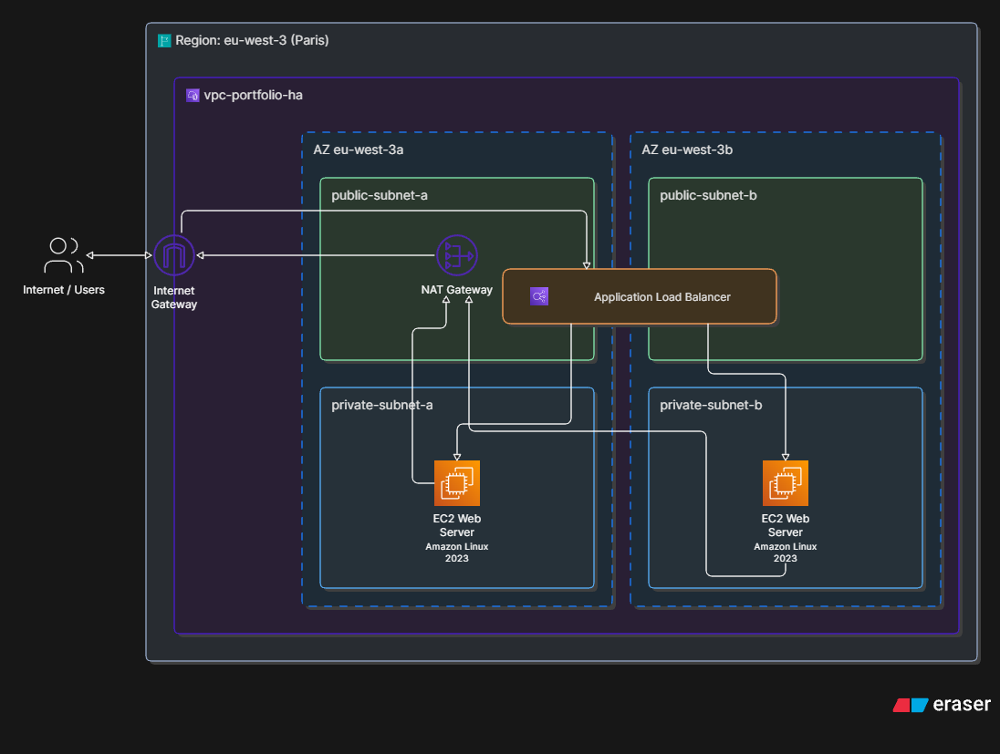
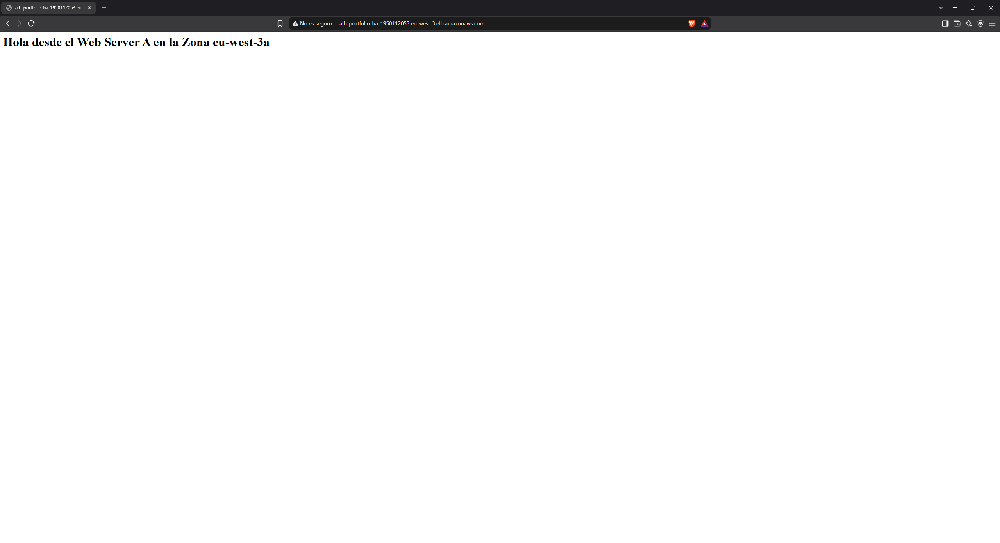
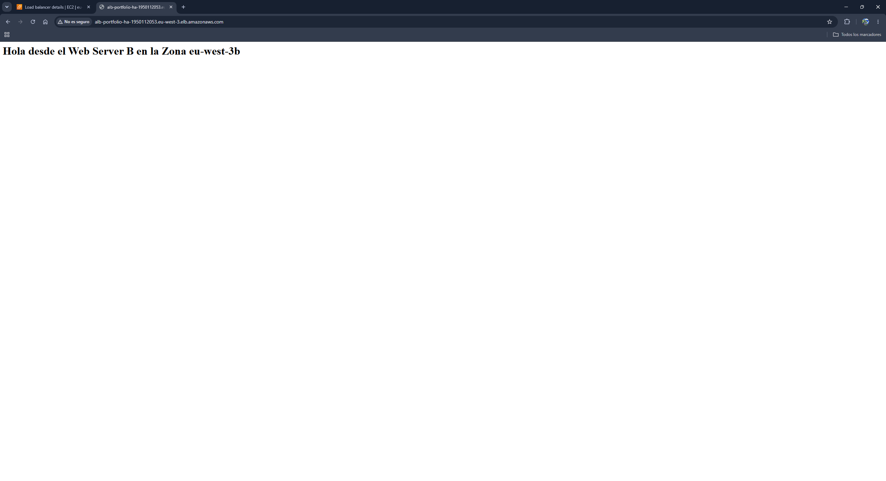
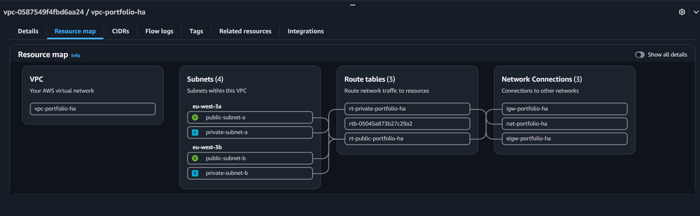

# Highly Available & Secure Web Architecture on AWS

## 📌 Project Overview
This project demonstrates the manual deployment of a highly available, secure, and fault-tolerant 2-Tier web architecture on Amazon Web Services (AWS). The infrastructure spans across two Availability Zones (AZs) in the `eu-west-3` (Paris) region, utilizing an Application Load Balancer (ALB) to distribute incoming traffic to private web servers.

## 🏗️ Architecture Diagram

## 🛠️ Technology Stack & AWS Services Used
* **Networking:** Amazon VPC (Dual-Stack IPv4/IPv6), Internet Gateway, NAT Gateway, Egress-Only Internet Gateway.
* **Compute:** Amazon EC2 (Amazon Linux 2023), Target Groups.
* **Security & Access:** Security Groups, EC2 Instance Connect Endpoints (EICE).
* **Traffic Routing:** Application Load Balancer (ALB).

## 🔒 Security & Design Decisions (The "Why")
Instead of a simple flat network, this architecture adheres to AWS Well-Architected Framework best practices:

1. **Private Subnet Isolation:** EC2 web servers are placed in private subnets with *no public IP addresses*. This eliminates the risk of direct attacks (e.g., SSH brute force or DDoS) from the public internet.
2. **Controlled Inbound Traffic:** An **Application Load Balancer (ALB)** resides in the public subnets. It acts as the only entry point for users, accepting HTTP traffic on port 80 and securely routing it internally to the private servers. 
3. **Controlled Outbound Traffic:** A **NAT Gateway** was deployed in the public subnet to allow the private web servers to download OS patches and software updates (Apache) without exposing them to inbound internet traffic.
4. **Secure Terminal Access:** Bastion Hosts were avoided to reduce the attack surface and costs. Instead, an **EC2 Instance Connect Endpoint** was created inside the VPC, allowing secure, private CLI access through the AWS Console using IAM authentication.

## 🚀 Deployment Steps (ClickOps)
1. **Network Infrastructure:** Created a custom VPC with 2 public and 2 private subnets across `eu-west-3a` and `eu-west-3b`. Configured Route Tables for public (IGW) and private (NAT Gateway) traffic.
2. **Security Groups:** Created `alb-public-sg` (allowing port 80 from `0.0.0.0/0` and `::/0`) and `web-private-sg` (allowing ports 22 and 80 *only* from the VPC CIDR `10.16.0.0/16`).
3. **Compute:** Launched two EC2 `t2.micro` instances in the private subnets. Installed and configured Apache using user scripts (see `/scripts`).
4. **Load Balancing:** Configured a Target Group and attached an Internet-facing ALB with Dual-Stack support to distribute traffic across both AZs.

## 📸 Visual Evidences & Validation

### 1. High Availability / Load Balancing Response
Cuando se accede a la URL pública del Balanceador de Carga, el tráfico se alterna dinámicamente entre ambas zonas de disponibilidad:

| Server A Response (eu-west-3a) | Server B Response (eu-west-3b) |
| :---: | :---: |
|  |  |

### 2. Target Group Health Status
Ambos servidores privados registrados y superando correctamente las comprobaciones de estado (*Health Checks*):

### 3. VPC Network Topology & Resource Map
Mapa de recursos de la VPC que detalla la separación en 2 capas (subredes públicas y privadas) y el enrutamiento mediante NAT e Internet Gateways:

## 🔮 Future Improvements
* Migrate the ClickOps manual configuration into **Infrastructure as Code (IaC)** using Terraform.
* Register a custom domain using **Amazon Route 53** and configure an SSL/TLS certificate via **AWS Certificate Manager (ACM)** for end-to-end HTTPS encryption.