# Proyecto 04: Arquitectura web de alta disponibilidad con Terraform (Auto Scaling + HTTPS)

## 📌 Visión general

Reconstrucción con **Terraform** de la arquitectura del [proyecto 03](../03-high-availability-architecture), corrigiendo las limitaciones que allí dejé documentadas: servidores sin Auto Scaling, security groups demasiado abiertos, solo HTTP y despliegue manual.

El resultado es una capa web **multi-AZ** en `eu-west-3` (París): un Application Load Balancer con **HTTPS** en `ha.oscarfragueiro.com` reparte el tráfico entre servidores que viven en **subredes privadas** y son gestionados por un **Auto Scaling Group**. Toda la infraestructura (36 recursos) se crea con `terraform apply` y se elimina con `terraform destroy`.

> **Estado:** el entorno está destruido para evitar costes, así que `ha.oscarfragueiro.com` ya no responde (el registro DNS también se elimina). Las evidencias de abajo son capturas del despliegue real.

## 🏗️ Diagrama de arquitectura

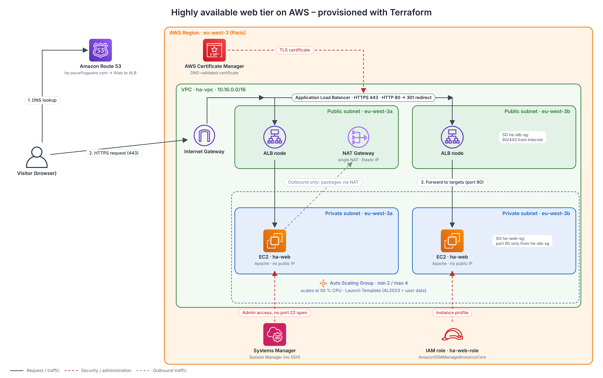

## 🛠️ Servicios de AWS utilizados

| Capa | Servicios |
| :--- | :--- |
| **Red** | VPC, subredes públicas y privadas en 2 zonas, Internet Gateway, NAT Gateway, tablas de rutas |
| **Balanceo y escalado** | Application Load Balancer, Target Group, Launch Template, Auto Scaling Group con política de escalado por CPU |
| **DNS y cifrado** | Route 53 (registro Alias), AWS Certificate Manager (certificado regional validado por DNS) |
| **Seguridad y acceso** | Security Groups encadenados, IAM (rol con mínimo privilegio), Systems Manager Session Manager, IMDSv2 |
| **Infraestructura como código** | Terraform + proveedor `hashicorp/aws` |

## 🔒 Decisiones de diseño (el "porqué")

1. **Security groups que se referencian entre sí.** `ha-web-sg` solo acepta el puerto 80 **desde `ha-alb-sg`**, no desde todo el CIDR de la VPC como en el proyecto 03. Aunque otro recurso entre en la VPC, no puede hablar con los servidores web.
2. **Auto Scaling Group en vez de instancias manuales.** Mantiene 2 servidores (mínimo 2, máximo 4) repartidos en las dos zonas. Usa comprobaciones de salud del balanceador (`health_check_type = "ELB"`), así que reemplaza una instancia que falla aunque la máquina siga encendida. Una política de *target tracking* añade servidores si la CPU media supera el 50 %.
3. **Launch Template + script de arranque.** Cada servidor nuevo instala Apache y publica una página con su ID y su zona mediante un script (`user-data.sh`). Ya no hay pasos manuales ni servidores "únicos". La imagen se obtiene de un parámetro público de AWS, por lo que siempre es la última Amazon Linux 2023.
4. **HTTPS con redirección.** El listener 443 usa un certificado de ACM (política TLS 1.3/1.2) y el listener 80 responde con un `301` a HTTPS. A diferencia del [proyecto 02](../02-cloud-resume-challenge), donde el certificado tenía que estar en `us-east-1` por CloudFront, el de un ALB es **regional** y va en la misma región que el balanceador.
5. **Sin SSH ni puerto 22.** En lugar del EC2 Instance Connect Endpoint del proyecto 03, los servidores se administran con **Session Manager**. El rol de IAM solo lleva la política gestionada `AmazonSSMManagedInstanceCore`.
6. **IMDSv2 obligatorio** en el Launch Template, para reducir el riesgo de robo de credenciales del servidor.
7. **NAT Gateway configurable.** La variable `nat_per_az` elige entre un NAT único (más barato, valor por defecto) y uno por zona (más resiliente, más caro).
8. **El estado de Terraform nunca va a Git.** El `.gitignore` excluye `*.tfstate`, `.terraform/` y `*.tfvars`; el `.terraform.lock.hcl` sí se versiona para fijar la versión del proveedor.

### Security Groups

| Security group | Dirección | Puerto | Origen / destino |
| :--- | :---: | :--- | :--- |
| `ha-alb-sg` | Entrada | TCP 80 y 443 | `0.0.0.0/0` |
| `ha-alb-sg` | Salida | TCP 80 | `ha-web-sg` |
| `ha-web-sg` | Entrada | TCP 80 | `ha-alb-sg` |
| `ha-web-sg` | Salida | Todo | `0.0.0.0/0` (necesario para instalar paquetes y para Systems Manager, a través del NAT) |

## 📂 Estructura del código

| Archivo | Contenido |
| :--- | :--- |
| `providers.tf` | Versión de Terraform y del proveedor AWS, región y etiquetas por defecto |
| `variables.tf` | Variables de entrada (región, rangos de red, tipo de instancia, dominio…) |
| `network.tf` | VPC, subredes, Internet Gateway, NAT Gateway y tablas de rutas |
| `security.tf` | Security groups y sus reglas |
| `compute.tf` | Imagen, rol de IAM y Launch Template |
| `alb.tf` | Balanceador, Target Group y listeners (HTTPS y redirección HTTP) |
| `asg.tf` | Auto Scaling Group y política de escalado |
| `dns.tf` | Certificado de ACM, validación por DNS y registro Alias en Route 53 |
| `outputs.tf` | DNS del balanceador y URL final |
| `user-data.sh` | Script que se ejecuta al arrancar cada servidor |

### Variables

| Variable | Valor por defecto | Descripción |
| :--- | :--- | :--- |
| `region` | `eu-west-3` | Región de despliegue |
| `vpc_cidr` | `10.16.0.0/16` | Rango de la VPC (las subredes se calculan con `cidrsubnet`) |
| `azs` | `eu-west-3a`, `eu-west-3b` | Zonas de disponibilidad |
| `nat_per_az` | `false` | `true` = un NAT por zona |
| `instance_type` | `t2.micro` | Tipo de instancia de los servidores |
| `domain_name` | `oscarfragueiro.com` | Dominio con zona alojada en Route 53 |
| `subdomain` | `ha` | Subdominio donde se publica la web |

## 🚀 Cómo desplegarlo

Requisitos: Terraform ≥ 1.9, AWS CLI v2 y un dominio con zona alojada en Route 53.

```bash
aws login                # credenciales temporales, sin claves permanentes en el equipo
terraform init
terraform plan
terraform apply
# ...
terraform destroy        # elimina los 36 recursos
```

## 📸 Validación y evidencias

### 1. HTTPS en el dominio propio, con respuesta de ambas zonas

Al refrescar `https://ha.oscarfragueiro.com`, responde un servidor distinto cada vez:

| Servidor 1 | Servidor 2 |
| :---: | :---: |
|  | 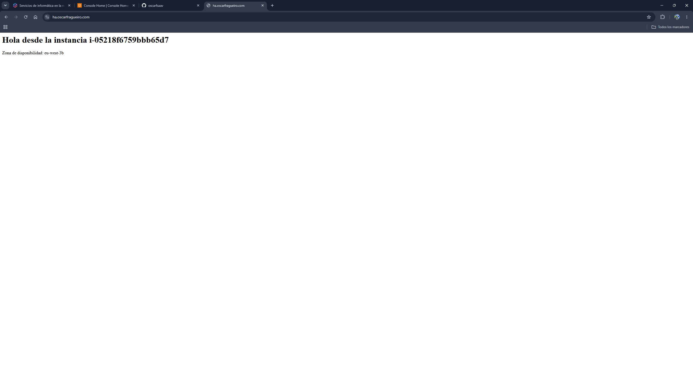 |

### 2. Redirección de HTTP a HTTPS

`curl -I http://ha.oscarfragueiro.com` devuelve un `301` con destino HTTPS:

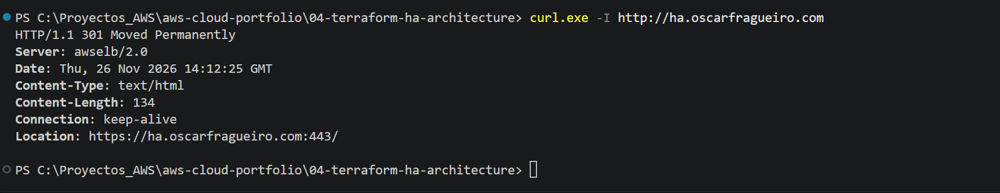

### 3. Target Group y Auto Scaling Group

Los dos servidores están sanos, uno en cada zona, y el grupo mantiene la capacidad deseada:

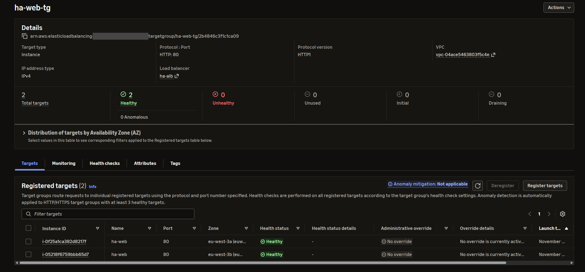

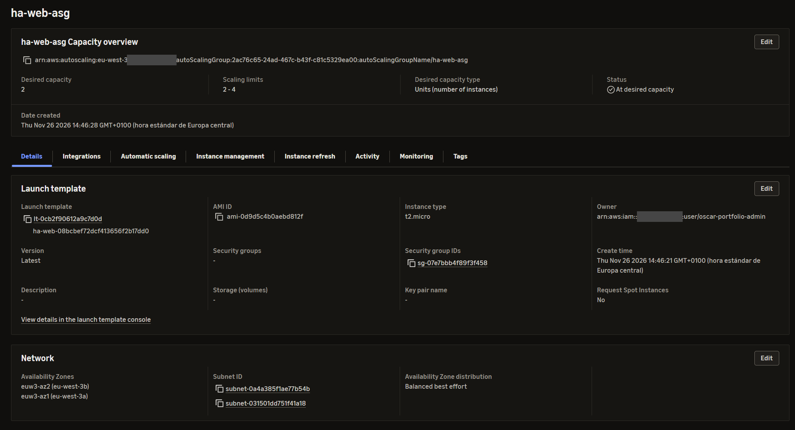

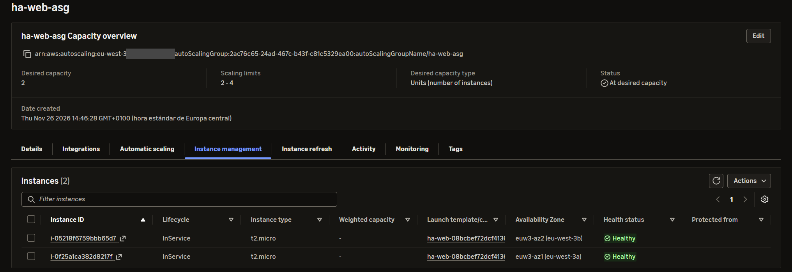

### 4. Mapa de recursos de la VPC

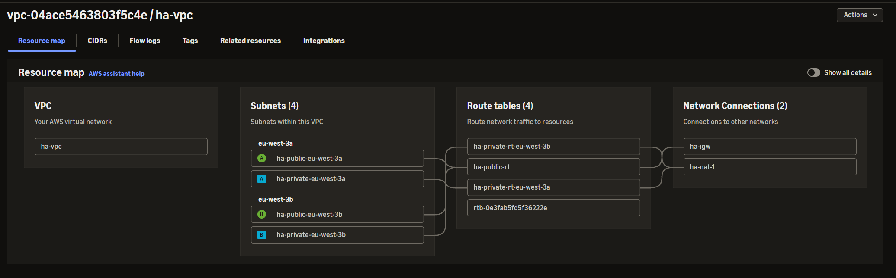

### 5. Administración sin SSH

Sesión abierta en un servidor con Session Manager, sin puerto 22 ni claves SSH:

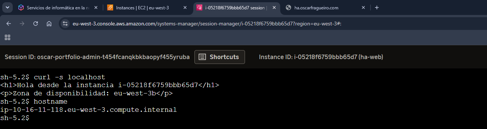

## 🔥 Prueba de fallo

Eliminé a mano una de las dos instancias (la de `eu-west-3a`) mientras refrescaba la web desde el navegador.

| Hora (CET) | Qué ocurrió |
| :--- | :--- |
| 15:28:26 | Elimino la instancia desde la consola de EC2 |
| 15:28:26 | El Auto Scaling Group detecta que ya no existe y la da de baja |
| 15:28:28 | Lanza una instancia sustituta |
| 15:28:33 | El lanzamiento se completa |

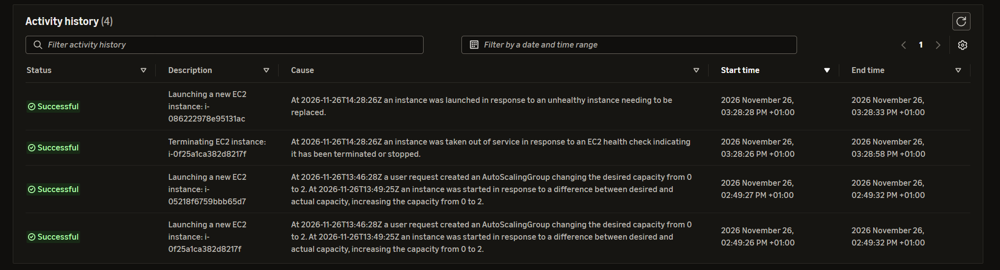

Unos minutos después, la instancia nueva ya estaba registrada y sana en el Target Group, junto a la que no toqué:

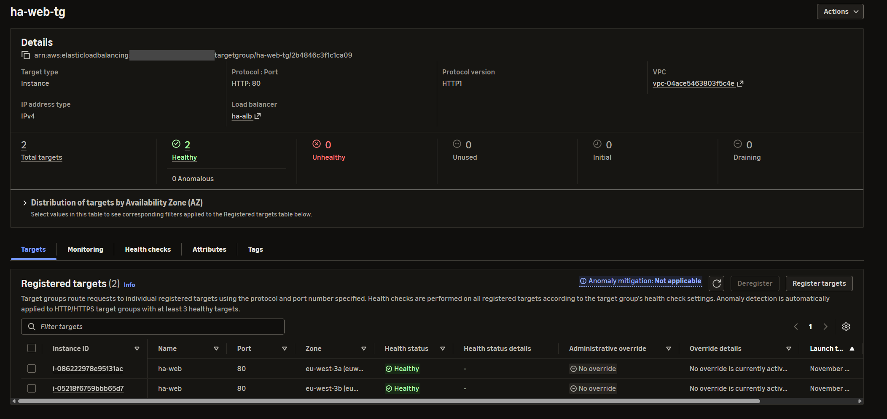

**Resultado:** durante la prueba la web siguió respondiendo desde la instancia de `eu-west-3b`, y el sistema volvió a tener 2 servidores sanos sin intervención manual.

**Matices:** refresqué a mano varias veces y no vi errores, pero no medí la disponibilidad de forma sistemática. Con comprobaciones de salud cada 15 s y dos fallos seguidos para marcar un servidor como no sano, el balanceador puede tardar alrededor de 30 s en dejar de enviarle tráfico, y en ese margen alguna petición podría fallar con un `502` o `504`. Además, simulé el fallo de **una instancia**, no el de **una zona de disponibilidad completa**.

## 🧠 Lecciones aprendidas

* **El certificado de un ALB es regional.** El de CloudFront va en `us-east-1`, pero el de un balanceador debe estar en la región del balanceador. Terraform además espera a que ACM valide el certificado antes de crear el listener HTTPS.
* **Despliegues por fases.** Fui desplegando por partes (primero HTTP, después HTTPS) y revisando cada `terraform plan` antes del `apply`. Así sabía exactamente qué iba a crear o cambiar, y un error se localiza mucho más fácil con menos piezas nuevas.
* **El plan como prueba.** Tras el despliegue, `terraform plan` devolvió `No changes`: lo que hay en AWS coincide con el código. El primer `apply` del cambio de listener mostró un aviso del proveedor (`default_action` con `redirect`), que no afectó al resultado y desapareció en el plan siguiente.
* **Protege el estado antes del primer `apply`.** El archivo `terraform.tfstate` puede contener datos sensibles y no debe llegar a Git. Lo dejé excluido en el `.gitignore` antes de crear ningún recurso.
* **Credenciales temporales.** Con `aws login` no hay claves permanentes guardadas en el equipo; si caducan, basta repetir el comando.
* **Cerrar el ciclo de costes.** Tras `terraform destroy` comprobé con la CLI de AWS que no quedaban NAT Gateways ni balanceadores.
* **Revisar las capturas antes de publicarlas.** La salida de `terraform destroy` y los ARN de la consola incluyen el número de cuenta; lo tapé en las capturas antes de subirlas.

## 💰 Coste y limpieza

El entorno estuvo desplegado unas 3 horas (de las 12:38 a las 15:41, hora de Madrid). Los recursos que cobran por hora son el **NAT Gateway**, el **ALB** y las dos instancias, y se eliminaron con `terraform destroy` justo después de documentar. Después comprobé con la CLI que no quedaba ningún NAT Gateway ni balanceador:

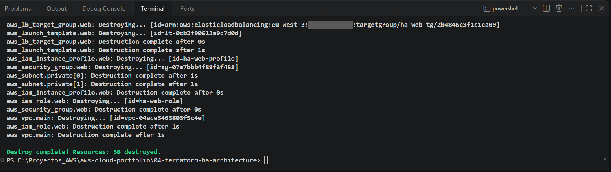

## ⚖️ Limitaciones conocidas

| Limitación | Impacto | Qué haría en un entorno de producción |
| :--- | :--- | :--- |
| **Estado de Terraform local** | El `tfstate` vive en mi equipo: no hay bloqueo ni copia compartida. | Backend remoto en S3 con bloqueo de estado. |
| **Todo el código en una carpeta, sin módulos** | Menos reutilizable. | Módulos (red, seguridad, cómputo) con variables propias. |
| **Un único NAT Gateway por defecto** | Si cae su zona, los servidores de la otra pierden la salida a Internet (la entrada por el ALB no se ve afectada). | `nat_per_az = true`. Esta opción está en el código, pero **no la he desplegado ni probado**. |
| **Solo IPv4** | A diferencia del proyecto 03, no incluye doble pila. | Añadir IPv6 a la VPC, subredes y balanceador. |
| **Escalado probado solo por fallo, no por carga** | Comprobé el reemplazo de una instancia, pero no que el grupo añada servidores bajo carga. | Prueba de carga y revisión de las métricas de escalado. |
| **Sin alarmas ni registros de acceso** | No me avisaría nadie si hay hosts no sanos o errores 5xx. | Alarmas de CloudWatch y registros de acceso del ALB. |
| **Sin capa de datos** | Es una capa web sin estado. | Base de datos gestionada (RDS Multi-AZ) en subredes privadas dedicadas. |
| **Despliegue lanzado a mano** | `terraform apply` desde mi ordenador, sin revisión automática. | Pipeline que ejecute `plan` en cada cambio y `apply` con aprobación. |

## 🔮 Roadmap

- [ ] Backend remoto del estado en S3 con bloqueo.
- [ ] Separar el código en módulos.
- [ ] Alarmas de CloudWatch (hosts no sanos y errores 5xx) y registros de acceso del ALB.
- [ ] Prueba de carga para comprobar el escalado automático.
- [ ] Desplegar y probar `nat_per_az = true`.
- [ ] Pipeline con GitHub Actions (`terraform plan` en cada cambio, autenticación con OIDC).

## 🗂️ Estructura del repositorio

```
04-terraform-ha-architecture/
├── README.md
├── .gitignore
├── .terraform.lock.hcl
├── providers.tf
├── variables.tf
├── network.tf
├── security.tf
├── compute.tf
├── alb.tf
├── asg.tf
├── dns.tf
├── outputs.tf
├── user-data.sh
└── images/
```
